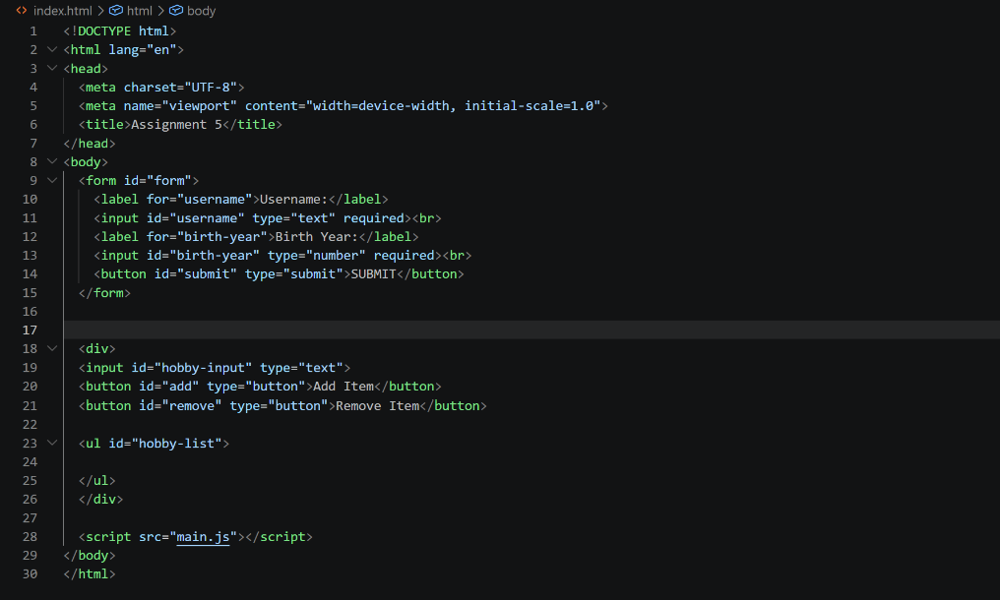
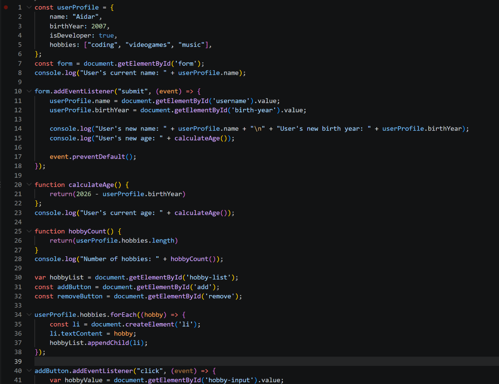
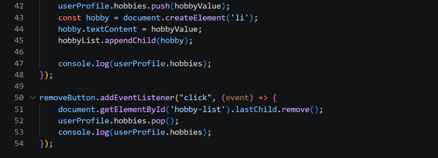

# Assignment 5: JavaScript Basics

**Student:** Aidar Murat  
**Group:** SE - 2539

## Project overview

This project demonstrates JavaScript objects, arithmetic calculations, form events, and DOM list manipulation. The page lets a user update profile information and add or remove hobbies.

## Assignment tasks

### Part 1: Profile Object, Data Types, and Arithmetic

The `userProfile` object in `main.js` contains a name (string), birth year (number), developer status (boolean), and hobbies (array). The script calculates age by subtracting the birth year from 2026 and reports the number of hobbies in the browser console.

### Part 2: Form Input and Event Responses

The page includes Username and Birth Year inputs and a submit button. On form submission, the event listener updates the corresponding `userProfile` properties and logs the updated profile information and calculated age. The form's default submission is prevented so the page does not reload.

### Part 3: DOM List Manipulation

The hobbies array is displayed as an unordered list. The Add Item button appends the entered hobby to the array and page; the Remove Item button removes the last hobby from both.

### Screenshots

## Work summary

I created a profile object with different JavaScript data types, used arithmetic and array properties for calculations, and connected form and button events to update the data and page. I also used DOM methods to create and remove list items. The project can be opened locally in a browser without installing dependencies.
